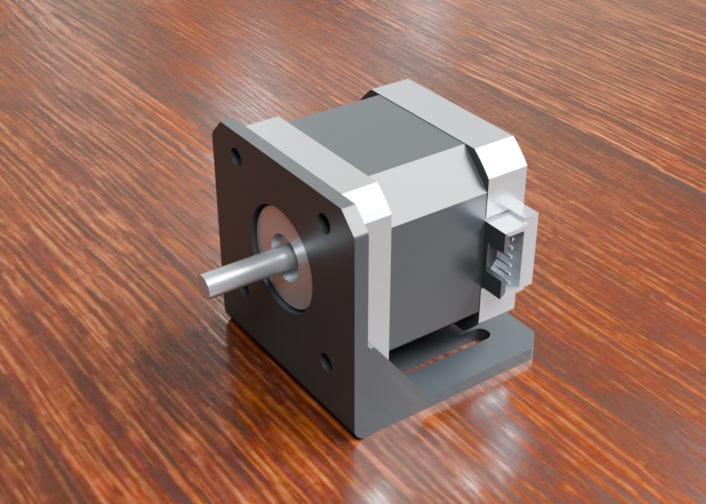
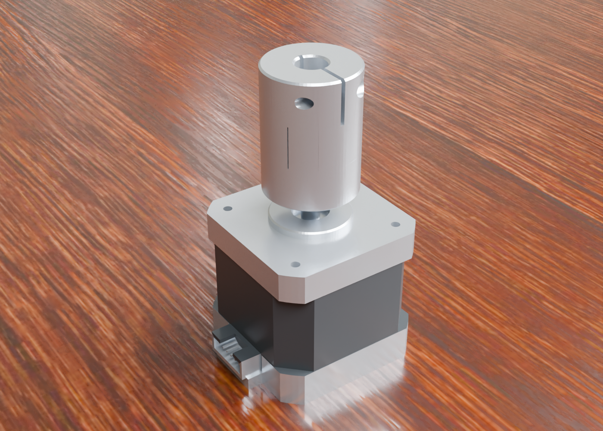
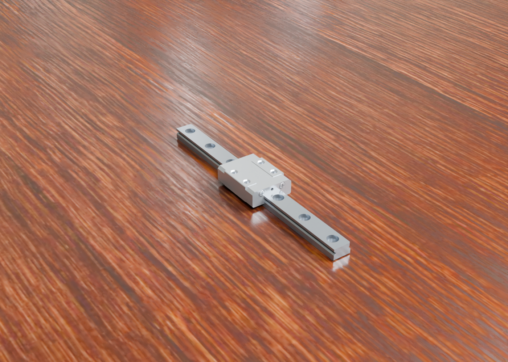
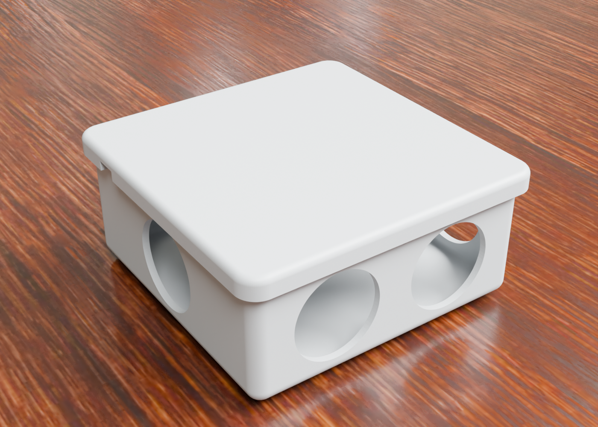
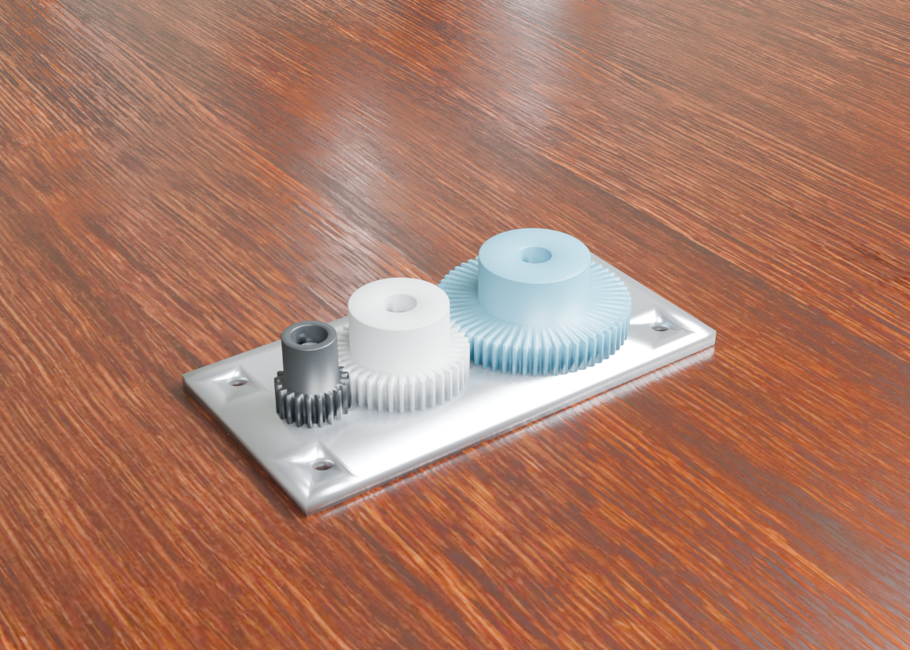

# AlphaNIST: Unofficial Implementation

[](https://arxiv.org/abs/2610.13354)
[](https://alpha-nist.github.io)
[](pyproject.toml)

An **unofficial**, independent PyTorch implementation of **[AlphaNIST: Emergent Assembly Skills from Binary Task Rewards](https://arxiv.org/abs/2610.13354)** (arXiv:2610.13354, NVIDIA Seattle Robotics Lab, Octi Zhang and colleagues): multi-task robot assembly reinforcement learning with PPO, binary task rewards and success-guided reset sampling, in the spirit of the NIST Assembly Task Board. Maintained by [Anuj Zore](https://github.com/ZoreAnuj); unaffiliated with the paper's authors, NVIDIA, the University of Washington, or NIST. The authors have not released official code at the time of writing; see the [project page](https://alpha-nist.github.io) for their videos.

The learning core runs independently of the simulator. Full simulation uses the robot and task assets described in [setup](docs/setup.md).

[Setup](docs/setup.md) · [Training and evaluation](docs/training.md) · [Provenance and acknowledgments](docs/provenance.md) · [Citation](CITATION.bib)

## Research scope

The implementation combines point-cloud observations, separate actor and critic networks, PPO, success-guided reset sampling, and physics-validated reset banks. The current experimental setting uses a six-axis UR7e with a parallel-jaw gripper and ten industrial assembly tasks. Newton/MuJoCo-Warp advances physics; Isaac Sim renders scene and recorded-state previews.

This is an adaptation, not an exact reproduction of the paper's Franka/NIST benchmark. Point aggregation, robot dimensions, collision geometry, reset validation, and several unspecified optimizer defaults are explicit implementation choices. Their sources and differences are recorded in [provenance](docs/provenance.md) and `policy.CONFIG_PROVENANCE`.

## Rendered task gallery

These are existing **assembled-target renders** from the experimental scenes, not policy rollouts or evidence of learned success. Source geometry credits and image-specific terms are in [image provenance](docs/provenance.md#rendered-images).

| Motor seated in bracket | Flexible shaft coupling |
| :---: | :---: |
|  |  |
| Linear guide | Enclosure and lid |
|  |  |



*Gear assembly: NVIDIA IndustRealKit source geometry; this image is subject to the included [NVIDIA research/evaluation license](third_party/IndustReal-NVIDIA.txt).*

## Quick start: learning core

```bash
python3.12 -m venv .venv
source .venv/bin/activate
python -m pip install --upgrade pip
python -m pip install -e '.[test]'
python -m isaac.assembly_rl.train --help
OMP_NUM_THREADS=1 python -m pytest -q \
  src/python/isaac/assembly_rl/policy_unit_test.py \
  src/python/isaac/assembly_rl/trainer_unit_test.py \
  src/python/isaac/assembly_rl/reset_sampling_unit_test.py \
  src/python/isaac/assembly_rl/geometry_unit_test.py
```

These checks cover policy/PPO behavior, reset sampling, geometry, checkpoint/resume, and frozen evaluation using small synthetic environments. They do not run robot physics or establish convergence. See [setup](docs/setup.md) before running a simulator command.

## Code map

| Module in `src/python/isaac/assembly_rl/` | Purpose |
| --- | --- |
| `policy.py` | Point encoder, residual actor/critic, normalization, PPO/GAE |
| `train.py` | Rollouts, distributed updates, checkpoints, held-out evaluation |
| `reset_sampling.py` | Reset representation and success-guided sampling |
| `reset_bank_builder.py`, `merge_reset_banks.py` | Physics validation and balanced bank assembly |
| `environment.py`, `model.py`, `physics_step.py` | UR7e task physics and control |
| `prepare_*`, `collision_*` | Source geometry and collision preparation |
| `preview.py` | Recorded-state export and rendering |

No CAD meshes, reset-bank data, checkpoints, credentials, infrastructure configuration, or production logs are included. Project-specific source is published for inspection without a blanket license grant; see [LICENSE](LICENSE) and [third-party notices](NOTICE).

## Citation

GitHub shows a "Cite this repository" button from [CITATION.cff](CITATION.cff). Please cite the original paper when using the method, and acknowledge this repository separately when using this implementation. The paper's results belong to its authors.

```bibtex
@article{zhang2026alphanist,
  title   = {{AlphaNIST}: Emergent Assembly Skills from Binary Task Rewards},
  author  = {Zhang, Octi and Akinola, Iretiayo and Scalise, Rosario and
             Guaman Castro, Mateo and Yin, Patrick and Widmer, Tobias and
             Macklin, Miles and Amevor, Chris and Turpin, Dylan and
             Van Gelder, Dirk and Carius, Jan and Handa, Ankur and
             State, Gavriel and Guo, Yunrong and Narang, Yashraj},
  year    = {2026},
  journal = {arXiv preprint arXiv:2610.13354},
  doi     = {10.48550/arXiv.2610.13354},
  url     = {https://arxiv.org/abs/2610.13354}
}
```
